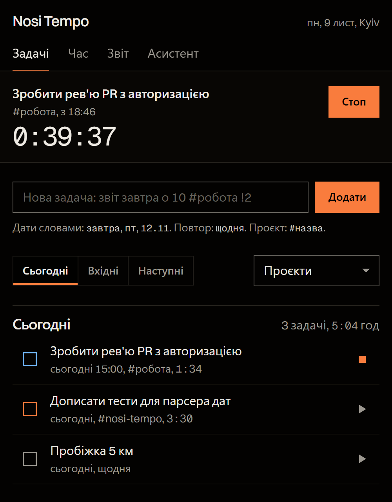
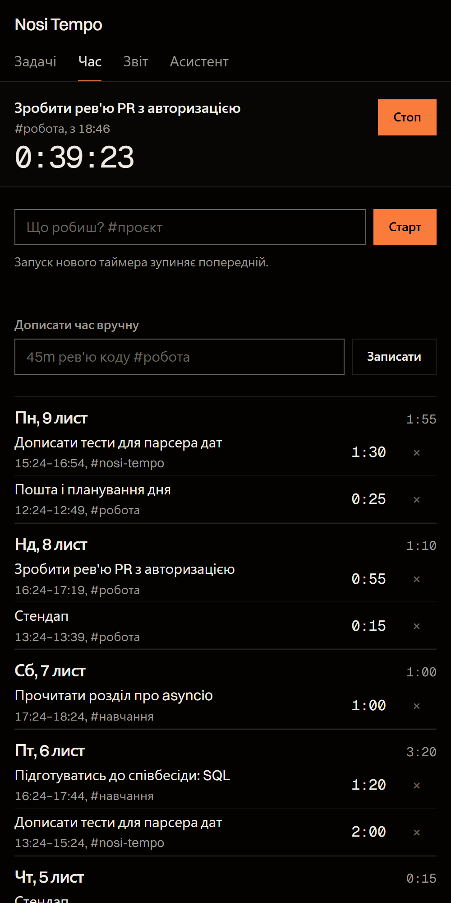
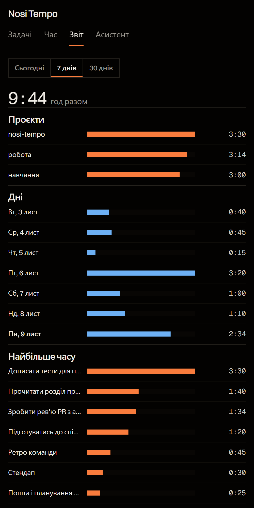

# Nosi Tempo

A personal task manager and time tracker that lives in Telegram: a chat bot for quick input
and a Mini App for everything else. Think of a small Todoist and Toggl Track in one place,
with an LLM assistant that can read your tasks and plan with you.

The interface is in Ukrainian.

<p>
  
  
  
</p>

## Features

**Tasks**
- Natural-language quick add, in the chat or the Mini App:
  `Подзвонити мамі завтра о 18:00 #дім !1` becomes a task due tomorrow at 18:00
  in the project «дім» with priority 1.
- Dates (`завтра`, `пт`, `12.11`, `через 3 дні`), times, projects, priorities.
- Recurring tasks (`щодня`, `по буднях`, `щоп'ятниці`, `кожні 2 дні`): completing one moves
  it to the next date instead of closing it.
- Today (with overdue), Inbox, Upcoming and per-project views.
- Reminders sent by the bot when a task's time comes.

**Time tracking**
- Start a timer from any task or with `/go title #project`. Starting a new timer stops
  the running one, so there are never two.
- Manual entries: `/log 45m code review #work`, `/log 1:30 design`.
- Reports for today, 7 and 30 days: totals by project, by day and by task.

**Assistant**
- Gemini, Claude or any OpenAI-compatible model, switchable per user.
- Sees open tasks, the running timer and the week's time, so it can answer
  "what should I do first?" with your actual data.
- Can create tasks: the model replies with `ADD: ...` lines that go through the same
  quick-add parser.

## Stack

- Python 3.11+, asyncio
- [aiogram 3](https://docs.aiogram.dev/) for the bot, aiohttp for the Mini App API
- SQLite via aiosqlite
- Mini App: plain HTML, CSS and JavaScript, no build step
- pytest

## How it works

One process runs both the bot (long polling) and the HTTP server for the Mini App,
sharing a single SQLite connection.

A few parts worth a look:

- **`parse.py`** turns free text into a task. Regexes use custom word boundaries so Cyrillic
  words with apostrophes (`п'ятниця`) are matched whole, and recurrence is parsed before plain
  weekdays so `кожного понеділка` is not read as "next Monday".
- **One running timer per user** is enforced by the database itself, with a partial unique
  index on `entries(user_id) WHERE stopped_at IS NULL`.
- **Reports** split an entry that crosses midnight between the two days.
- **Mini App auth**: every API request carries Telegram `initData`, checked with HMAC-SHA256
  against the bot token as described in the
  [Telegram docs](https://core.telegram.org/bots/webapps#validating-data-received-via-the-mini-app).
  `OWNER_IDS` limits the bot and the API to listed users.
- **AI providers** are called over plain HTTP with no SDKs, so adding one is a single function.

## Running locally

```bash
python -m venv .venv
source .venv/bin/activate        # Windows: .venv\Scripts\activate
pip install -r requirements.txt
cp .env.example .env             # set BOT_TOKEN, OWNER_IDS and optionally an AI key
python -m nosi_tempo
```

The Mini App is served on `PORT` (8080 by default). Telegram opens Mini Apps only over HTTPS,
so set `WEBAPP_URL` to a public address that proxies to it; the bot then adds a menu button.

To work on the UI without Telegram:

```bash
python scripts/dev_web.py        # http://127.0.0.1:8770, local dev database, no auth from localhost
```

Docker:

```bash
docker build -t nosi-tempo .
docker run -d --env-file .env -v tempo:/data -p 8080:8080 nosi-tempo
```

## Tests

```bash
pip install pytest
python -m pytest
```

Covered: the quick-add and duration parsers, recurrence rules, task views, timers and reports,
and `initData` signature checks.

## Structure

```
nosi_tempo/
  __main__.py     entry point: bot and web server in one event loop
  bot.py          commands, inline keyboards, reminders
  server.py       Mini App API and initData validation
  db.py           SQLite schema and queries
  parse.py        quick-add and duration parsing
  ai.py           Gemini, Claude and OpenAI-compatible clients
  fmt.py          formatting helpers
  web/static/     Mini App
tests/
scripts/dev_web.py
```
